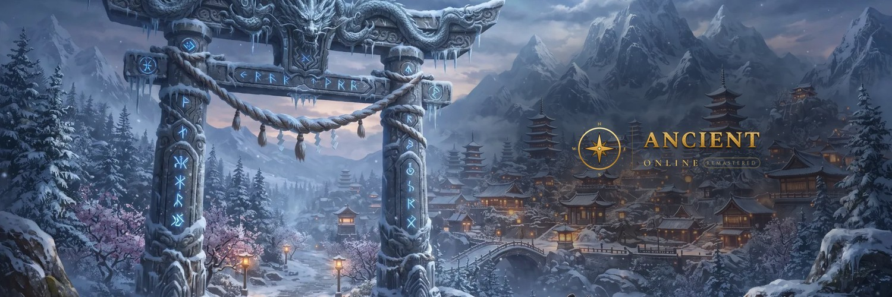

  

# Astronaut Entertainment

Independent game studio, founded in September 2019. We build persistent online worlds that run on desktop and
mobile, and develop our own server technology alongside Unreal Engine 5.8.

## Ancient Online: Remastered

A modern remake of the classic eastern-fantasy empire MMORPG. Choose one of the rival empires, fight for territory
in open-world PvP, hunt in contested grounds and dungeons, push your gear through high-risk upgrades and lead your
guild in castle sieges.

- **Engine:** Unreal Engine 5.8, with an in-house authoritative game server
- **Platforms:** Windows, Linux, macOS, Android, iOS
- **Languages:** 30
- **Status:** in development
- **No pay-to-win:** the in-game shop offers only cosmetics and convenience items, never combat power

## Links

- Game: [ancient.astent.games](https://ancient.astent.games/)
- Studio: [astent.games](https://astent.games/)
- News: [astent.games/news](https://astent.games/news)
- Press kit (logos, key art, fact sheet): [astent.games/press](https://astent.games/press)
- Careers: [astent.games/careers](https://astent.games/careers)
- Community: [Discord](https://discord.gg/7RjHMWe7cQ)
- Press contact: press@astent.games
